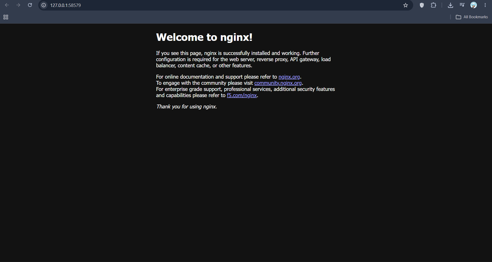

# Exercise 1: Kubernetes Getting Started

## Objective
Deploy an Nginx web server (simulating Zepto's storefront app) on a local Kubernetes cluster and expose it using a NodePort Service.

## Prerequisites
- Docker Desktop
- kubectl
- Minikube v1.39.0 (Kubernetes v1.37.0)

## Implementation
- Started a local Kubernetes cluster using Minikube with the Docker driver.
- Deployed an Nginx Pod named `hello-k8s` from `pod.yaml`.
- Exposed port 80 using a NodePort Service from `service.yaml`.
- Opened the app in the browser with `minikube service hello-k8s`.

## Commands Used

    minikube start --driver=docker
    kubectl get nodes
    kubectl apply -f pod.yaml
    kubectl get pods
    kubectl apply -f service.yaml
    kubectl get services
    minikube service hello-k8s

## Output

    $ kubectl get nodes
    NAME       STATUS   ROLES           AGE   VERSION
    minikube   Ready    control-plane   36s   v1.37.0

    $ kubectl get pods
    NAME        READY   STATUS    RESTARTS   AGE
    hello-k8s   1/1     Running   0          22s

    $ kubectl get services
    NAME         TYPE        CLUSTER-IP      EXTERNAL-IP   PORT(S)        AGE
    hello-k8s    NodePort    10.110.91.177   <none>        80:31899/TCP   0s
    kubernetes   ClusterIP   10.96.0.1       <none>        443/TCP        2m36s

## Screenshot
The Nginx welcome page, reached through the Minikube tunnel at `127.0.0.1:58579`:

## What Happens Internally
1. `kubectl` sends the Pod manifest to the **kube-apiserver** over a REST API.
2. The API server stores the desired state in **etcd**.
3. The **kube-scheduler** sees an unscheduled Pod and picks a worker node with enough CPU and memory.
4. The **kubelet** on that node is told to run the Pod.
5. The container runtime pulls the `nginx` image and starts the container in isolated Linux namespaces.
6. The **CNI** plugin assigns the Pod a unique IP, reachable inside the cluster.
7. The kubelet reports back to the API server that the Pod is `Running`.

## Notes
- With the Docker driver on Windows, `minikube service` creates a tunnel, so the terminal must stay open while viewing the page.

## Files
- `pod.yaml`: Kubernetes Pod manifest.
- `service.yaml`: NodePort Service manifest.
- `screenshots/`: Evidence of the working deployment.

## Cleanup

    kubectl delete -f service.yaml
    kubectl delete -f pod.yaml
