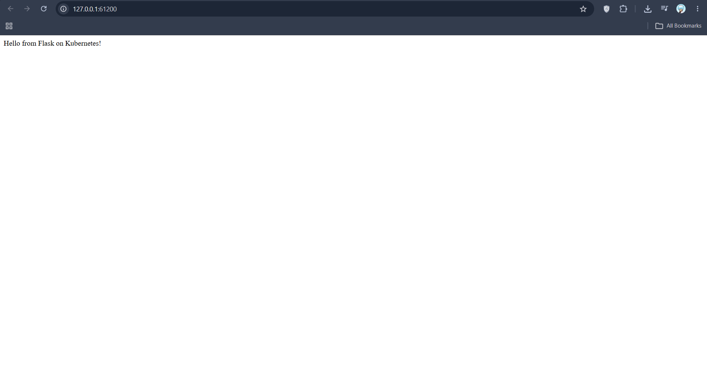

# Exercise 2: Deploy a Flask App on Minikube

## Objective
Package a Python Flask app as a Docker image, deploy it to a single-node Minikube cluster using a Kubernetes Deployment, and expose it with a NodePort Service.

## Prerequisites
- Docker Desktop
- kubectl
- Minikube v1.39.0 (Kubernetes v1.37.0)

## Implementation
1. Wrote a small Flask app (`app.py`) listening on port 15000.
2. Wrote a `Dockerfile` based on `python:3.8-slim`.
3. Built the image `flask-app:latest` and loaded it into Minikube.
4. Created a Deployment (`flask-deployment.yaml`) with `imagePullPolicy: Never`, so Kubernetes uses the local image instead of pulling from a registry.
5. Confirmed the Pod was running and read its logs.
6. Found the app unreachable from outside the cluster (`curl` to port 15000 failed).
7. Added a NodePort Service (`flask-app-service`, port 15000 -> targetPort 15000) to the same YAML file and opened it with `minikube service`.

## Commands Used

    minikube start
    docker build -t flask-app .
    minikube image load flask-app:latest
    kubectl apply -f flask-deployment.yaml
    kubectl get deployments
    kubectl get pods -l app=flask-app
    kubectl describe deployment flask-app
    kubectl logs deployment/flask-app
    kubectl get services
    kubectl apply -f flask-deployment.yaml   (after adding the Service)
    minikube service flask-app-service

## Output

    $ kubectl get deployments
    NAME        READY   UP-TO-DATE   AVAILABLE   AGE
    flask-app   1/1     1            1           96s

    $ kubectl get pods -l app=flask-app
    NAME                         READY   STATUS    RESTARTS   AGE
    flask-app-6cf84b85dd-g52pd   1/1     Running   0          49s

    $ kubectl logs deployment/flask-app
     * Serving Flask app 'app'
     * Debug mode: off
     * Running on all addresses (0.0.0.0)
     * Running on http://127.0.0.1:15000
     * Running on http://10.244.0.5:15000
    Press CTRL+C to quit

Before the Service existed, the app could not be reached from outside the cluster:

    $ curl.exe http://127.0.0.1:15000
    curl: (7) Failed to connect to 127.0.0.1:15000 after 2028 ms: Could not connect to server

## Screenshot
After adding the Service, the app is reachable through the Minikube tunnel:

## Why the curl failed, and how the Service fixes it
The container listens on port 15000 inside the Pod network, which is not reachable from the host. A Service gives the Pod a stable address. With `type: NodePort`, it is also exposed on a port of the node, and `minikube service` creates a tunnel to it. The request path is:

    Client -> Service (port 15000) -> Pod / container (targetPort 15000)

## Notes
- On Windows, `minikube docker-env` failed with the containerd runtime (`SSH_AGENT_START` error), so `docker build` ran in Docker Desktop instead of inside Minikube. The image was copied into the cluster with `minikube image load flask-app:latest`, and the Deployment was restarted with `kubectl rollout restart deployment/flask-app`.
- With the Docker driver on Windows, the terminal running `minikube service` must stay open while viewing the page.

## Files
- `app.py`: Flask application.
- `Dockerfile`: Container image definition.
- `flask-deployment.yaml`: Deployment and NodePort Service.
- `screenshots/`: Evidence of the working deployment.

## Cleanup

    kubectl delete -f flask-deployment.yaml
