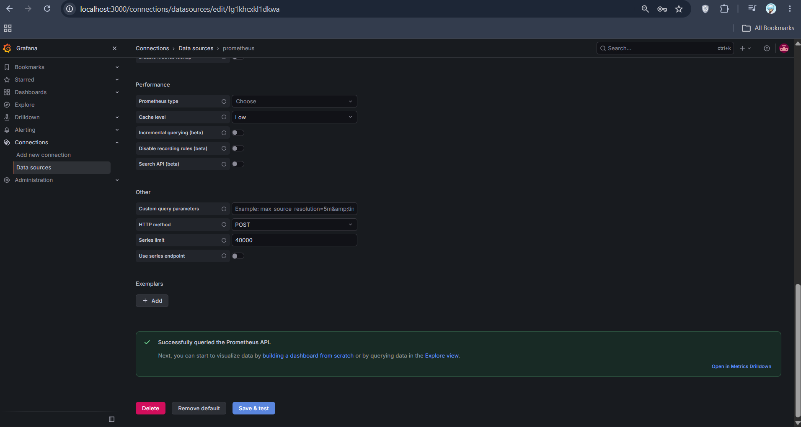
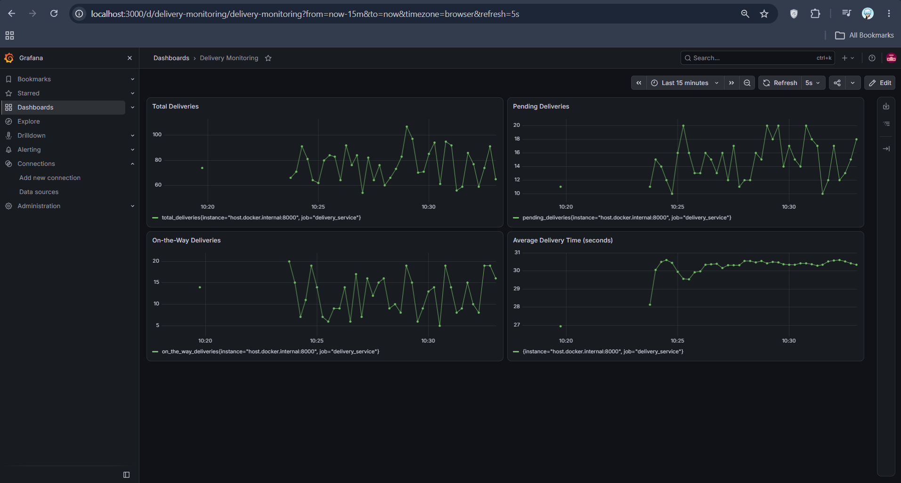

# Exercise 6: Real-Time Operations Monitoring and Alerting

## Objective
Build a monitoring pipeline for a simulated delivery service: a Python app exposes delivery metrics, Prometheus scrapes them and evaluates alert rules, Grafana visualises them, and Jenkins automates build and deployment of the stack.

## Architecture

    delivery_metrics.py (:8000/metrics)  <--scrape--  Prometheus (:9090)  <--query--  Grafana (:3000)
              ^                                              |
              |                                       alert_rules.yml
        built and started by Jenkins pipeline (:8080)

## Files

All files are in `delivery_monitoring/`:

- `delivery_metrics.py`: simulates deliveries and exposes `total_deliveries`, `pending_deliveries`, `on_the_way_deliveries` (Gauges) and `average_delivery_time` (Summary) on port 8000. The committed copy is in its Step 6 state (`pending = random.randint(50, 100)`).
- `prometheus.yml`: scrapes Prometheus itself and the `delivery_service` job at `host.docker.internal:8000`; loads the alert rules.
- `alert_rules.yml`: `HighPendingDeliveries` (`pending_deliveries > 10` for 15s, warning) and `HighAverageDeliveryTime` (`average_delivery_time_sum / average_delivery_time_count > 30`, critical).
- `Dockerfile`: packages the Python app (see Differences).
- `Jenkinsfile`: the 5-stage pipeline.
- `grafana-dashboard.json`: the 4-panel dashboard (exported so it can be re-imported).

## Steps and Results

### 1. Metrics application
The app runs in a container and serves metrics on `http://localhost:8000/metrics`:

    total_deliveries 109.0
    pending_deliveries 53.0
    on_the_way_deliveries 7.0

### 2. Prometheus
Started with the two config files mounted. Targets page/API shows both jobs healthy:

    scrapeUrl : http://host.docker.internal:8000/metrics   health : up
    scrapeUrl : http://localhost:9090/metrics              health : up

With the baseline range (pending 10-20) both alerts fired:

    HighPendingDeliveries     firing
    HighAverageDeliveryTime   firing

### 3. Grafana
Data source added with URL `http://host.docker.internal:9090` (Save & Test succeeded), and a dashboard with the four required panels was imported from `grafana-dashboard.json`.

### 4. Jenkins pipeline
Jenkins runs as a container (`jenkins/jenkins:lts`). Pipeline job `delivery-monitoring-pipeline` with the `Jenkinsfile` pasted as a Pipeline script. Build #1 result from the console log:

- Pre-check Docker: Docker client 26.1.5 and the daemon (Docker Desktop, server 29.5.3) reachable
- Setup Workspace: four files copied into `/var/jenkins_home/workspace/delivery-monitoring-pipeline`
- Build Docker Image: `delivery_metrics` image built
- Run Application: container `delivery_metrics` started on 8000
- Run Prometheus & Grafana: containers `prometheus` and `grafana` started

        Finished: SUCCESS

Verification after the build: `docker ps` showed `grafana`, `prometheus`, `delivery_metrics` and `jenkins` running, the Prometheus target was `up`, and both alerts were `firing` (`pending_deliveries` = 53).

### 5. Simulating alerts (Step 6)
Changed the app to `pending = random.randint(50, 100)`, rebuilt and restarted the container and Prometheus. After 60 seconds:

    pending_deliveries = 65
    HighPendingDeliveries   firing

`HighAverageDeliveryTime` depends on the running average of a random value between 15 and 45 seconds, so it hovers around the 30-second threshold and can be firing or not at any moment; it fired in other checks.

## Differences from the exercise instructions

The exercise was written for a Linux host. This was run on Windows 11 with Docker Desktop (WSL2), so these changes were needed:

- **Prometheus target:** `host.docker.internal:8000` instead of `172.17.0.1:8000` (the exercise's own note says to use `host.docker.internal` on Windows). `--network=host` is not used; ports are published with `-p 9090:9090`.
- **Grafana data source URL:** `http://host.docker.internal:9090` instead of `http://172.17.0.1:9090`.
- **Dockerfile added:** the exercise's Jenkinsfile runs `docker build` but no Dockerfile is provided, so one was written (`python:3.11-slim`, installs `prometheus-client`).
- **Metrics app runs in a container**, not as a native `python3` process (the native run was not reliably reachable from the Prometheus container on Windows during testing).
- **Alert rules file name:** the exercise's directory listing says `alerts_rules.yml` but its config and commands use `alert_rules.yml`; `alert_rules.yml` is used.
- **Jenkins container:** started with the exercise's command plus `--user root`, the Docker socket (`/var/run/docker.sock`) and a read-only mount of the project folder at `/local_files`. The Docker CLI (`docker.io` package) was installed inside the container so `sh 'docker ...'` steps work.
- **Jenkinsfile, Setup Workspace:** `localSourcePath` is `/local_files` (the mounted folder) instead of the placeholder path, and the Dockerfile is copied as well.
- **Jenkinsfile, Prometheus stage:** config files are delivered with `docker create` + `docker cp` instead of `-v $WORKSPACE/...` bind mounts, because the Docker daemon resolves bind-mount paths on the Docker host, not inside the Jenkins container.
- **Jenkinsfile, re-runnability:** added `docker rm -f ... || true` before starting containers.
- **Dashboard:** built as JSON (four time-series panels) and imported, instead of by hand in the UI; the panel queries are exactly those specified.
- **Admin password retrieval:** `docker exec jenkins cat /var/jenkins_home/secrets/initialAdminPassword` instead of an interactive shell (same file).

## Cleanup

    docker rm -f jenkins prometheus grafana delivery_metrics
