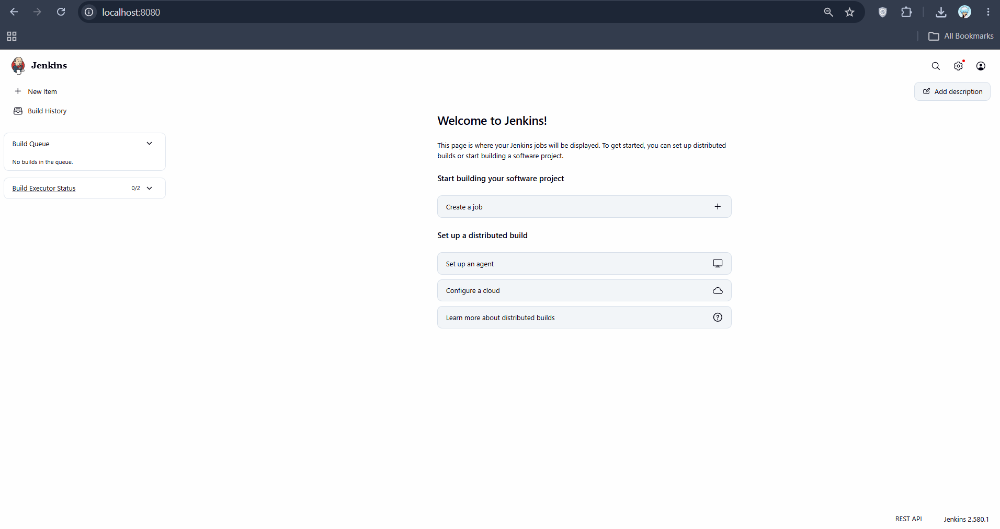

# Exercise 7: Introduction to CI and Jenkins Installation

## Objective
Understand what Continuous Integration (CI) is, how it works, which tools exist, and install Jenkins with Docker and reach its web UI.

## Concepts

**Continuous Integration** is the practice of integrating code into a shared repository frequently. Each commit triggers an automated build and automated tests, so integration problems and bugs are found early and developers get quick feedback.

How a CI workflow runs:

1. A developer pushes code to a Git repository.
2. The CI server detects the change and triggers a build.
3. The code is built and dependencies are resolved.
4. Automated tests (unit, integration) run.
5. The result (success or failure) is reported back to the developers.

Benefits: early bug detection, better collaboration on one codebase, faster development cycles, and higher code quality through continuous testing.

**CI tools** covered in the exercise material: Jenkins, GitLab CI/CD, CircleCI, Travis CI, Bamboo, TeamCity, Azure DevOps Pipelines, GitHub Actions, Spinnaker, Buildkite and Drone. They differ mainly in hosting (self-hosted vs cloud), how pipelines are defined (YAML vs scripts vs UI) and which ecosystem they integrate with (GitLab, Atlassian, Azure, GitHub). GitHub Actions was already used in Exercise 5 of this portfolio.

**Jenkins** is an open-source automation server for building, testing and deploying software. Key concepts:

- **Job/Project**: a task Jenkins runs.
- **Build**: one run of a job.
- **Pipeline**: a series of steps (build, test, deploy), usually defined in a `Jenkinsfile`.
- **Plugins**: extend Jenkins (Git, Docker, and so on).
- **Nodes**: machines that run jobs (controller and agents).

Jenkins is used for automation of repetitive tasks, CI, extensibility through plugins, and scalability through distributed builds.

## Installation

Jenkins was installed with Docker. Any container or volume left over from Exercise 6 was removed first so the name, ports and data were clean:

    docker rm -f jenkins prometheus grafana delivery_metrics
    docker volume rm jenkins_home

Start Jenkins (exactly the command from the exercise):

    docker run -d --name jenkins -p 8080:8080 -p 50000:50000 jenkins/jenkins:lts

- Port `8080` is the web interface.
- Port `50000` is used by build agents to connect to the controller.

Verify that the container is running:

    docker ps -a --filter name=jenkins

    CONTAINER ID   IMAGE                 COMMAND                  CREATED                  STATUS                  PORTS
    39d96ef4cd7c   jenkins/jenkins:lts   "/usr/bin/tini -- /u?"   Less than a second ago   Up Less than a second   0.0.0.0:8080->8080/tcp, 0.0.0.0:50000->50000/tcp   jenkins

Get the initial admin password:

    docker exec jenkins cat /var/jenkins_home/secrets/initialAdminPassword

Open `http://localhost:8080`, paste the password into the **Unlock Jenkins** screen, choose **Install suggested plugins**, create the first admin user, and finish with **Start using Jenkins**. The Jenkins dashboard (landing page) loaded successfully.

## Differences from the exercise instructions

- Ran on Windows 11 with Docker Desktop (PowerShell) instead of Linux.
- The password was read with a single `docker exec jenkins cat ...` instead of opening an interactive shell with `docker exec -it ... bash` and running `cat` there; it reads the same file.
- The exercise's sample output shows a different container ID and password; those values are generated per installation.
- Only the landing-page screenshot is included; the other two installation screens (unlock, getting started) were completed in the browser but not captured.

## Cleanup / notes

The container is left running because the next Jenkins exercises build on this installation. To remove it:

    docker rm -f jenkins

